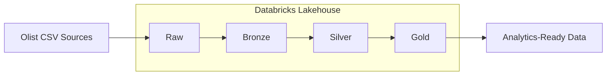

# Olist E-Commerce Data Engineering Lakehouse

## Project Overview

This project builds a data engineering lakehouse using the [Olist Brazilian E-Commerce Public Dataset](https://www.kaggle.com/datasets/olistbr/brazilian-ecommerce).

The objective is to transform a collection of raw e-commerce CSV files into a reliable, structured and analytics-ready data platform using modern data engineering practices.

The project follows a medallion architecture, separating raw ingestion, data cleansing and dimensional modeling into Bronze, Silver and Gold layers.

Beyond implementing the data pipeline, the project focuses on data quality, reproducibility, dimensional modeling, referential integrity and documenting engineering decisions.

**Project status:** Bronze, Silver and Gold layers implemented and validated. Incremental processing, orchestration, automated testing and further platform integration are planned.

## Technology Stack

| Technology | Purpose |
|---|---|
| Databricks | Lakehouse development and execution environment |
| Apache Spark / PySpark | Distributed data processing |
| Delta Lake | Reliable, transactional data storage |
| Unity Catalog | Data organization, governance and discoverability |
| Git / GitHub | Version control and project documentation |
| Google Cloud Platform | Planned cloud storage and platform integration |

## Project Documentation

The README provides an overview of the project. Detailed technical documentation is maintained separately.

| Document | Description |
|---|---|
| [Data Modeling](docs/data_modeling.md) | Gold dimensional model, table grains, surrogate keys, relationships and SCD strategy |
| [Data Quality](docs/data_quality.md) | Validation methodology, integrity checks, source-data anomalies and known limitations |

## Architecture

The project follows the medallion architecture:

| Layer | Responsibility |
|---|---|
| Raw | Original source files stored in Unity Catalog Volumes |
| Bronze | Source data ingested into Delta tables, retaining original fields and ingestion metadata |
| Silver | Cleaned, typed, deduplicated and validated datasets |
| Gold | Dimensional model consisting of fact and dimension tables |

The layers are organized in the Unity Catalog catalog `lakehouse`, using the schemas `raw`, `bronze`, `silver` and `gold`.

### Bronze

All nine source datasets are ingested into Delta tables.

The Bronze layer preserves the original source fields and includes ingestion metadata:

- `ingestion_timestamp`
- `source_file`
- `batch_id`

Source columns are initially retained as strings to preserve the original input representation.

### Silver

The Silver layer contains nine cleaned and structured Delta tables:

- `orders`
- `order_items`
- `order_payments`
- `order_reviews`
- `customers`
- `sellers`
- `products`
- `geolocation`
- `product_category_name_translation`

Transformations include:

- Data type conversion.
- Null and invalid-value handling.
- Deduplication where applicable.
- Data validation and consistency checks.
- Preservation of source identifiers and relevant source attributes.

The Silver layer provides a consistent foundation for downstream modeling while retaining the meaning and traceability of the source data.

### Gold

The Gold layer contains a dimensional model designed to support analytical queries.

It consists of five dimensions and three fact tables.

**Dimensions**

- `dim_customers`
- `dim_geography`
- `dim_products`
- `dim_sellers`
- `dim_date`

**Fact tables**

- `fact_orders`
- `fact_order_items`
- `fact_payments`

The model separates orders, order items and payments because each represents a different business event grain.

See [Data Modeling Documentation](docs/data_modeling.md) for the detailed modeling rationale, key strategies, relationships and history-management considerations.

### Implementation Summary

| Layer | Source / Output | Implementation |
|---|---|---|
| Bronze | 9 Olist source datasets | Delta ingestion with source and batch metadata |
| Silver | 9 structured Delta tables | Data typing, cleansing, deduplication and validation |
| Gold | 5 dimensions and 3 fact tables | Dimensional modeling, surrogate keys and relationship validation |

All three layers have been implemented and persisted in Delta tables.

Bronze and Silver currently use a full-refresh baseline. Incremental processing and automated orchestration are planned.

## Key Design Decisions

Several modeling decisions were made deliberately rather than simply following a generic dimensional modeling template.

| Decision | Rationale |
|---|---|
| Deterministic surrogate keys | Hash-based keys provide reproducible identifiers derived from stable business attributes. |
| Composite geography identity | ZIP prefix alone is insufficient to identify a geographic combination; ZIP prefix, city and state are considered together. |
| Customer dimension grain | `customer_unique_id` represents the underlying shopper, whereas multiple `customer_id` values can refer to the same shopper. |
| Shared date dimension | A single date dimension supports multiple order lifecycle dates through role-playing foreign keys. |
| Separate fact tables | Different grains prevent incorrect joins and double counting when analyzing orders, items and payments. |
| Initial Type 1 dimension semantics | The historical snapshot does not provide sufficient evidence to reconstruct reliable historical attribute changes. |

The detailed reasoning, implementation decisions and potential future evolution of the dimensional model are documented in [`docs/data_modeling.md`](docs/data_modeling.md).

## Gold Layer Validation

The Gold layer was validated after persistence to Delta tables.

### Table volumes

| Table | Rows |
|---|---:|
| `dim_geography` | 15,249 |
| `dim_customers` | 96,096 |
| `dim_products` | 32,951 |
| `dim_sellers` | 3,095 |
| `dim_date` | 800 |
| `fact_orders` | 99,441 |
| `fact_order_items` | 112,650 |
| `fact_payments` | 103,886 |

### Validation performed

- Expected table grain and row counts.
- Primary and composite key uniqueness.
- Null checks on required identifiers and keys.
- Surrogate key generation consistency.
- Foreign key integrity across all eleven modeled relationships.
- Join cardinality checks to detect unintended row multiplication.
- Source-to-Gold financial total reconciliation for item prices, freight and payments.

All eleven foreign key relationships passed orphan-record checks. Four tested join cardinality scenarios preserved their original row counts.

Financial reconciliation also identified discrepancies already present in the source dataset. These were retained and documented rather than silently adjusted.

See [Data Quality Documentation](docs/data_quality.md) for validation details and reconciliation findings.

## Known Source Data Issues and Future Analysis Opportunities

Data validation identified several source-data limitations worth preserving for future investigation.

| Issue | Finding |
|---|---|
| Orders without items | 775 orders |
| Orders without payments | 1 delivered order |
| Payment reconciliation | 303 differences among 98,665 comparable orders |
| Missing product categories | 610 products |
| Missing English category translations | 2 categories |
| Missing exact geolocation matches | 176 customer and 135 seller geographic combinations |

Financial reconciliation differences were calculated by comparing aggregated payment values against aggregated item prices and freight values at the order grain.

These exceptions are preserved rather than silently corrected or removed. They are not automatically interpreted as pipeline failures or evidence of financial misconduct.

A potential future anomaly analysis dashboard could investigate:

- Payment discrepancies by amount and direction.
- Payment type and installment count.
- Order status and purchase period.
- Orders missing item or payment records.
- Product category and geographic data completeness.

This would be a separate analytical exercise, not a reason to modify the source-faithful Gold facts.

See [Data Quality Documentation](docs/data_quality.md) for the detailed findings, validation methodology and future investigation opportunities.

## Repository Development Workflow

The project uses trunk-based development with:

- `main` as the primary branch.
- Feature branches for isolated development.
- Changes committed and integrated into `main` when complete.

Examples of feature branches include:

- `feature/bronze-layer`
- `feature/silver-layer`
- `feature/gold-layer`

## Future Engineering Work

The current implementation establishes the initial lakehouse foundation. Further engineering maturity is planned.

| Area | Planned work |
|---|---|
| Incremental processing | Implement repeatable incremental batch ingestion and processing |
| Idempotency | Ensure rerunning a batch does not introduce duplicate or inconsistent records |
| Change handling | Evaluate appropriate upsert and Delta MERGE strategies |
| Declarative Pipelines | Introduce managed pipeline definitions and expectations |
| Orchestration | Implement automated execution using Lakeflow Jobs |
| Testing | Add repeatable transformation and data quality tests |
| CI/CD | Introduce automated validation and deployment workflows |
| Cloud integration | Extend the platform with Google Cloud Storage and related GCP services |
| Observability | Improve monitoring, logging and operational visibility |
| Reproducibility | Add environment setup, source data preparation and execution instructions |

The Olist dataset is a historical snapshot. Incremental processing will therefore be demonstrated through controlled batch deliveries or simulated source updates, not presented as genuine source CDC or live streaming.

## Architecture and Data Model Visuals

The following visuals will be added as the engineering implementation approaches completion:

- **Table-level lineage:** Raw → Bronze → Silver → Gold, documented in `docs/architecture.md`.
- **Column-level lineage:** Selected Unity Catalog lineage examples, documented in `docs/architecture.md`.
- **Gold dimensional model ERD:** All eight Gold tables, columns, data types and primary and foreign key relationships, documented in `docs/data_modeling.md`.

These visuals will complement the written architecture and modeling documentation and will be generated from the implemented pipeline and persisted Gold schemas where possible.

## Project Status

| Component | Status |
|---|---|
| Databricks and Unity Catalog setup | Complete |
| Bronze ingestion | Complete |
| Silver transformations | Complete |
| Gold dimensional model | Complete |
| Gold integration validation | Complete |
| Detailed modeling documentation | In progress |
| Data quality documentation | In progress |
| Incremental batch processing | Planned |
| Idempotency and upsert handling | Planned |
| Declarative Pipelines | Planned |
| Lakeflow Jobs orchestration | Planned |
| Automated testing and CI/CD | Planned |
| GCP integration | Planned |
| Lineage and ERD documentation | Planned |

The project is being developed incrementally, with emphasis on sound data modeling, reliable processing, validation and maintainable engineering practices.